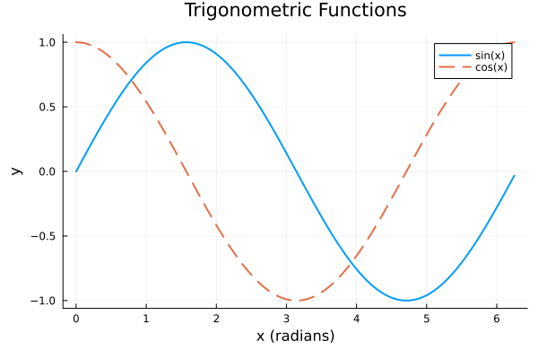

# julia-start

First steps in Julia

## Get a graph

First install the graphics library. This takes a while (327 seconds), but later makes the **Time To First Graph** much faster.

``` jl
using Pkg
Pkg.add("Plots")
```

Then the code

``` jl
using Plots

# 1. Generate data points from 0 to 2π
x = 0:0.05:2π

# 2. Plot the first curve
plot(x, sin.(x),
    label = "sin(x)",
    title = "Trigonometric Functions",
    xlabel = "x (radians)",
    ylabel = "y",
    linewidth = 2,
    legend = :topright
)

# 3. Add a second curve to the existing graph (note the !)
plot!(x, cos.(x), label = "cos(x)", linewidth = 2, linestyle = :dash)

# 4. Save to a file (also displays automatically in VS Code / Pluto / Jupyter)
savefig("trig_graph.png")
```

And you get:



## History

The application for science will come. This video inspired me: 

And you can get the first line like python

``` jl
print("Hello world!")
```
